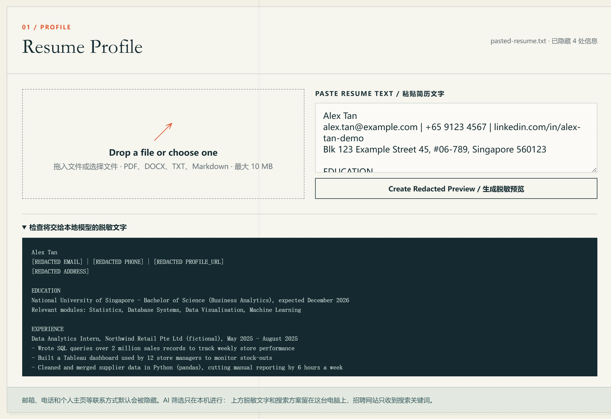
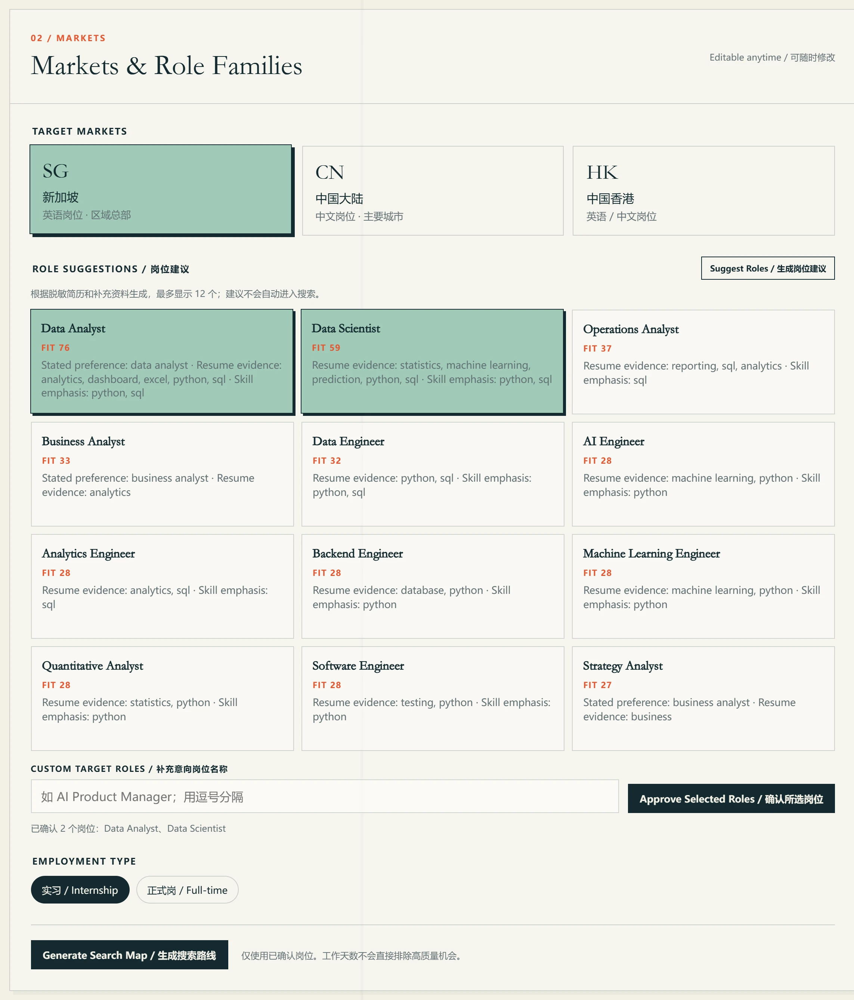
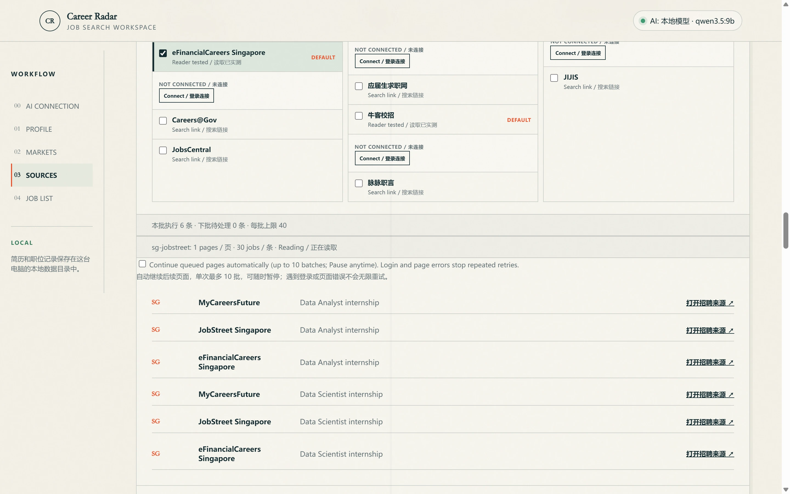
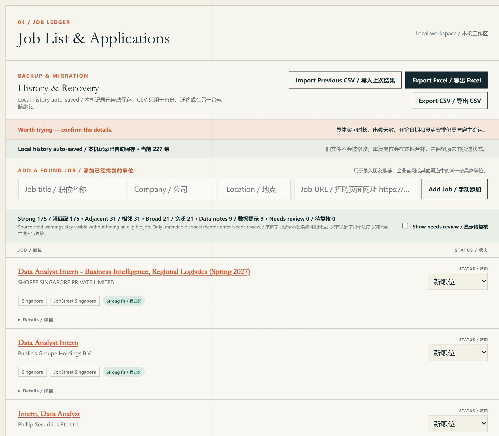
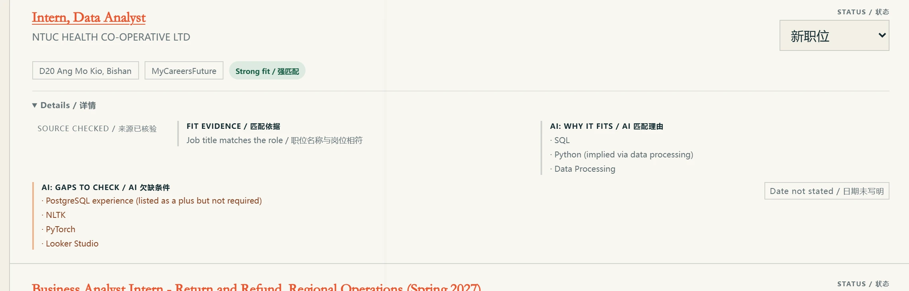
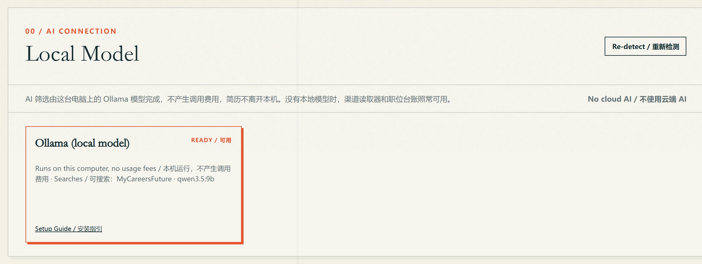

# Career Radar

[English](README.md) · [简体中文](README.zh-CN.md)

A Windows app for finding internships and full-time jobs in Singapore, mainland China and
Hong Kong. Give it a resume and it suggests roles, reads listings from the job sites you
choose, screens them with an AI model running on your own computer, and keeps everything in
one list you can track and export to Excel.


## How a search goes

### 1. Import a resume

Upload a PDF, DOCX, TXT or Markdown file, or paste the text. Email, phone, profile links and
street address are removed, and you see the redacted text before anything is searched.



### 2. Choose roles and markets

The app suggests up to 12 job titles from the resume, each with a score and the words behind
it. Only the titles you approve are searched.



### 3. Search

Each role and site becomes one task with its own search link. Most sites are read in their own
browser window, separate from your normal browser; sign in there when a site asks.
MyCareersFuture is searched by the AI model.



### 4. Review the list

Duplicates are merged and jobs are grouped as strong, adjacent or broad fits. Each one keeps its
link to the original listing and an application status. A search for data internships in
Singapore across three sites returns over 200 jobs in under three minutes.



### 5. See why the AI kept a job

For the listings it chooses, the AI notes why the job fits and what the resume is missing. The
title, company and link always come from the site, so the AI cannot make up a job.



### 6. Export to Excel

Internships and full-time jobs go on separate sheets, and a coverage sheet shows how far each
search got. A search that stopped at a sign-in, a CAPTCHA or a page limit continues next time.

## Job sites

Read by default: LinkedIn, JobStreet, Indeed, eFinancialCareers, BOSS直聘, 智联招聘, 前程无忧,
猎聘, 实习僧, 牛客, JobsDB and the Hong Kong Labour Department's iES. Other sites can be turned on
or come with a search link to open yourself. [Source verification](docs/source-verification.md)
lists what each reader handles.

## Local AI

Install [Ollama](https://ollama.com/) and a model that can call tools:

```powershell
ollama pull qwen3.5:9b
```

The app finds the model and starts Ollama when it is not running. There is no account, API key
or cost per search, and the resume stays on your computer. Without Ollama, everything except the
AI screening works.



## Run it

With Node.js 22 or later:

```powershell
npm install
npm run desktop
```

`npm start` opens the same workspace in a browser at <http://127.0.0.1:4317>, without the site
readers. The [user guide](START_HERE_USER.md) (Chinese) covers the Windows installer.

## Privacy

Resumes, jobs and application status are stored on your computer. Job sites only receive the
searches made in their own windows. Career Radar never applies to jobs, messages recruiters or
gets around a site's sign-in or CAPTCHA. See [Security and privacy](SECURITY.md) for details,
and [Design](docs/design.md) and [Contributing](CONTRIBUTING.md) for how it is built.

Screenshots use a fictional resume.

## License

Free to read and to use for your own job search; redistribution needs permission. See
[LICENSE](LICENSE).

Developed by shyfox-01 with assistance from Claude and Codex.
