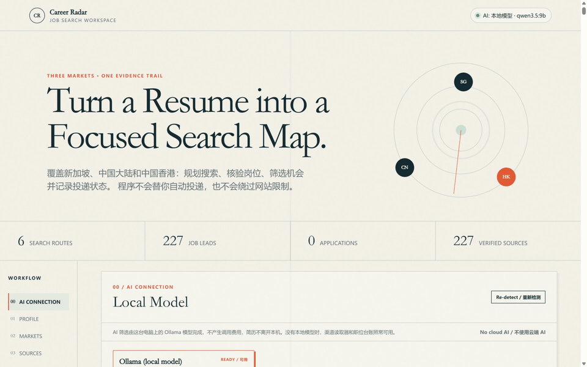
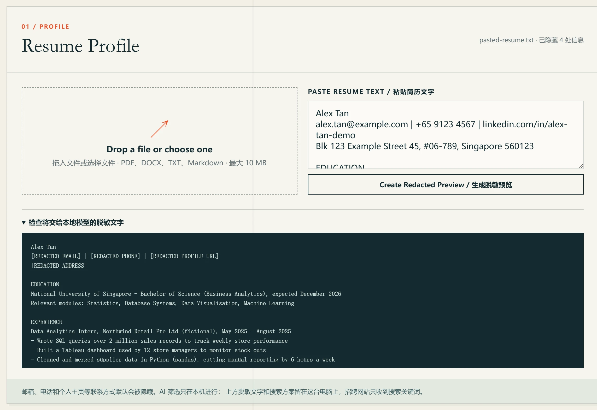
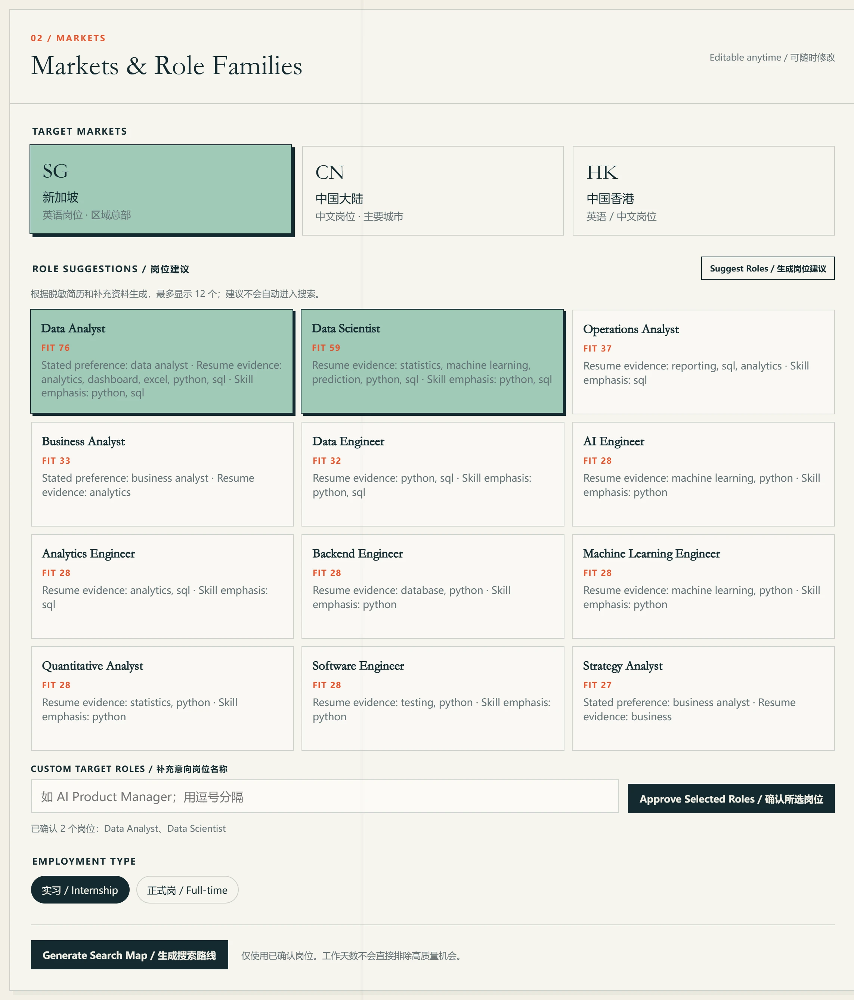
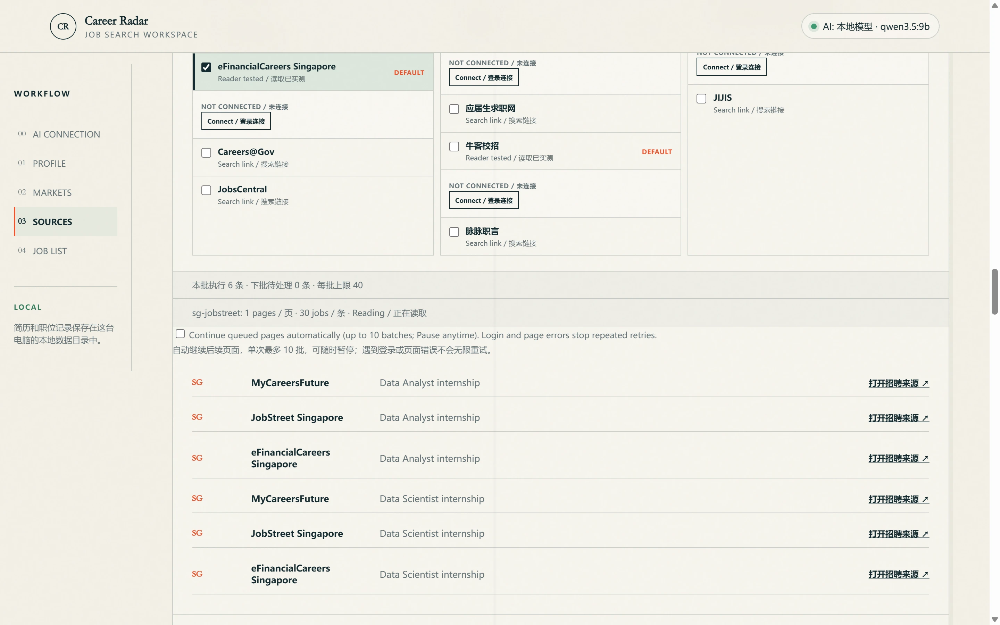
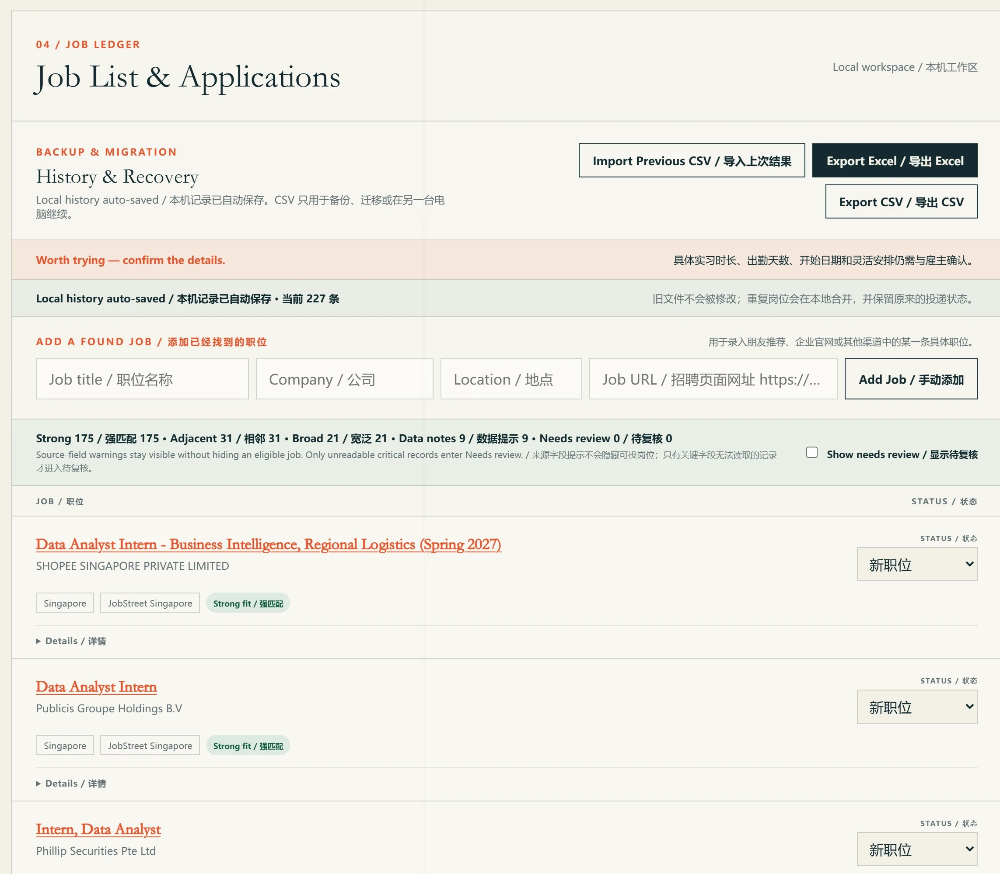
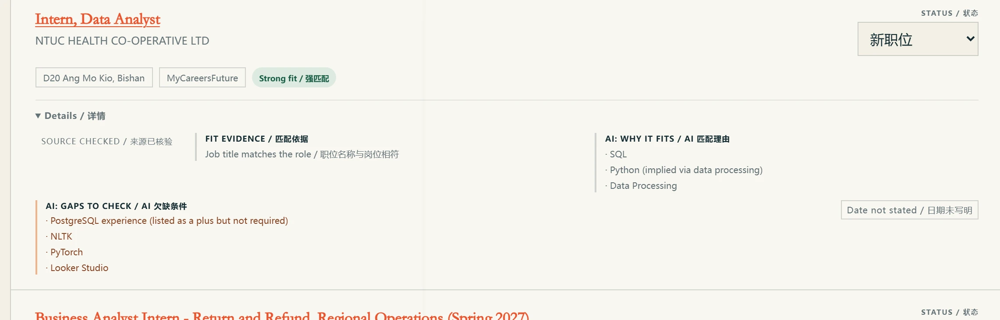
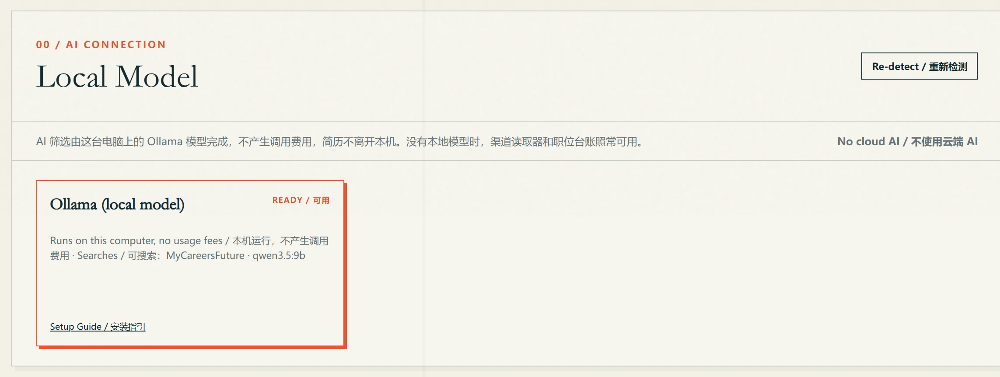

# Career Radar

[English](README.md) · [简体中文](README.zh-CN.md)

A Windows app for finding internships and full-time jobs in Singapore, mainland China and
Hong Kong. Give it a resume and it suggests roles, reads listings from the job sites you
choose, screens them with an AI model running on your own computer, and keeps everything in
one list you can track and export to Excel.



## Download

Download `CareerRadar-Setup-<version>.exe` from the
[latest release](https://github.com/shyfox-01/career-radar/releases/latest) and run it. It
runs on 64-bit Windows 10 or 11; AI screening and the MyCareersFuture search also need
Ollama (see [Local AI](#local-ai)).

- The installer is not code-signed yet, so Windows may say "Windows protected your PC".
  Choose **More info**, then **Run anyway**. Installing for yourself only is enough.
- The installed app checks for a new version when it starts, downloads it in the background
  and installs it when you close the app. Your data stays as it is.
- `CareerRadar-Portable-<version>.exe` runs without installing and keeps its records in a
  folder beside it. It does not update itself.

## How a search goes

### 1. Import a resume

Upload a PDF, DOCX, TXT or Markdown file, or paste the text. Email, phone, profile links and
street address are removed, and you see the redacted text before anything is searched.



### 2. Choose roles and markets

The app suggests up to 12 job titles from the resume, each with a score and the words behind
it. Only the titles you approve are searched.



### 3. Search

Each role and site becomes one task with its own search link. Most sites are read in their own
browser window, separate from your normal browser; sign in there when a site asks.
MyCareersFuture is searched by the AI model.



### 4. Review the list

Duplicates are merged and jobs are grouped as strong, adjacent or broad fits. Each one keeps its
link to the original listing and an application status.



### 5. See why the AI kept a job

For the listings it chooses, the AI notes why the job fits and what the resume is missing. The
title, company and link always come from the site, so the AI cannot make up a job.



### 6. Export to Excel

Internships and full-time jobs go on separate sheets, and a coverage sheet shows how far each
search got. A search that stopped at a sign-in, a CAPTCHA or a page limit continues next time.

## Job sites

Read by default: LinkedIn, JobStreet, Indeed, eFinancialCareers, BOSS直聘, 智联招聘, 前程无忧,
猎聘, 实习僧, 牛客, JobsDB and the Hong Kong Labour Department's iES. Other sites can be turned on
or come with a search link to open yourself.

## Local AI

Install [Ollama](https://ollama.com/) and a model that can call tools:

```powershell
ollama pull qwen3.5:9b
```

The app finds the model and starts Ollama when it is not running. There is no account, API key
or cost per search, and the resume stays on your computer. Without Ollama, everything except the
AI screening and the MyCareersFuture search works.



## Privacy

Resumes, jobs and application status are stored on your computer. Job sites only receive the
searches made in their own windows. Career Radar never applies to jobs, messages recruiters or
gets around a site's sign-in or CAPTCHA. See [Privacy](PRIVACY.md) for details.

Screenshots use a fictional resume.

## License

Free to use for your own job search; redistribution needs permission. See [LICENSE](LICENSE).
The source code is not public.

Developed by shyfox-01.
