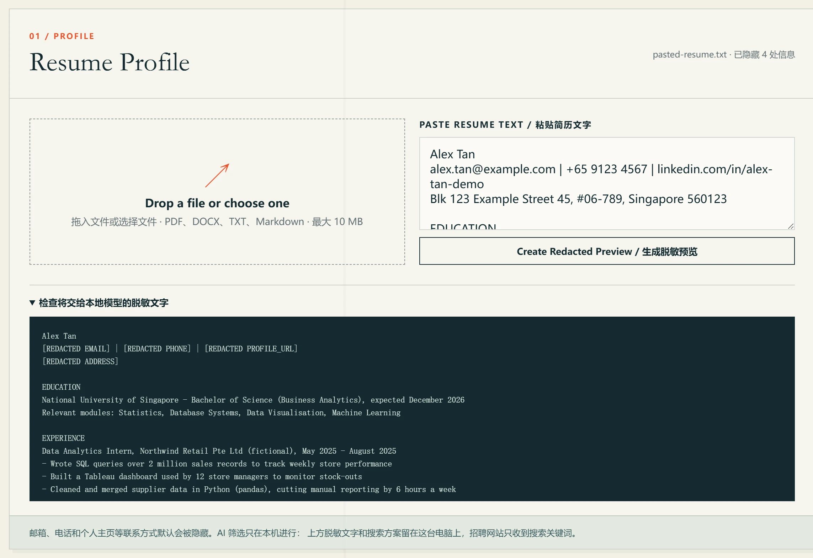
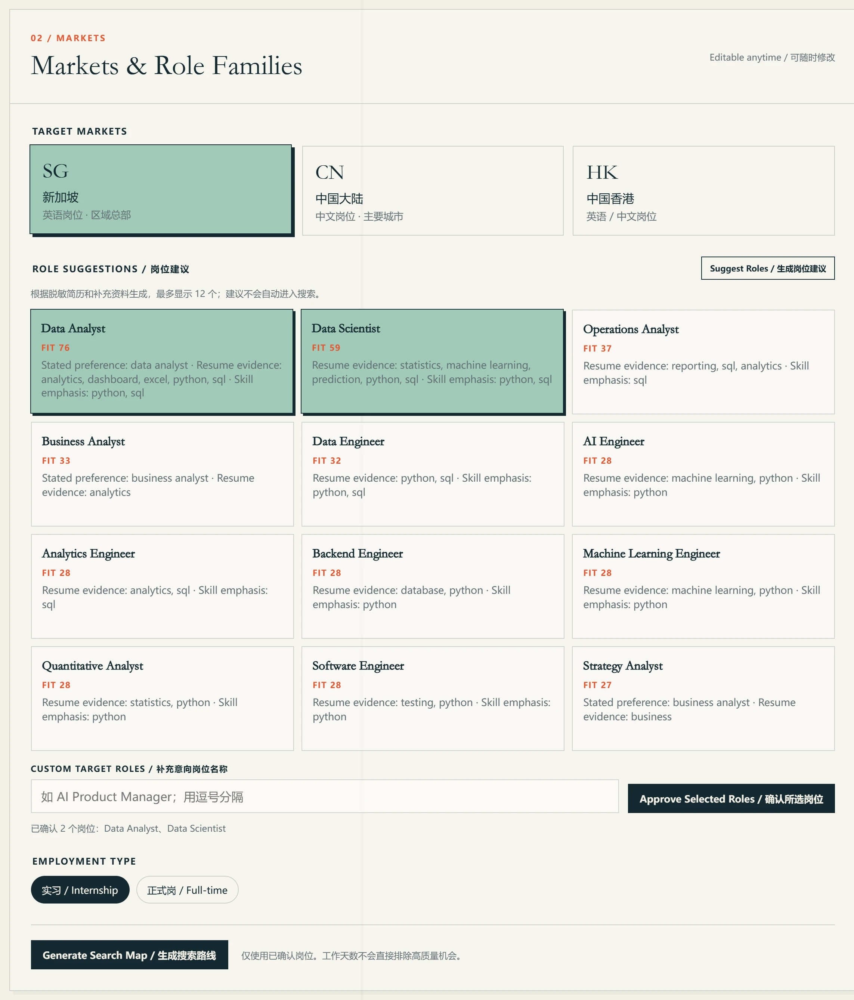
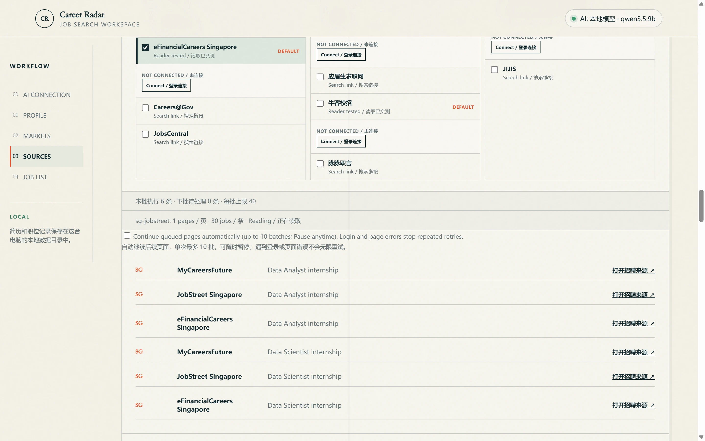
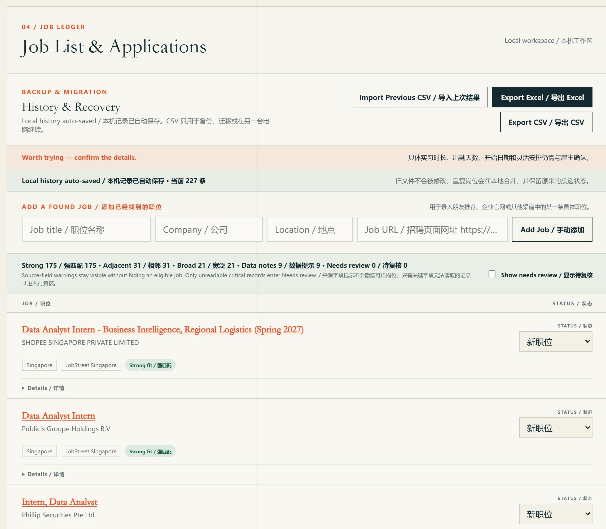
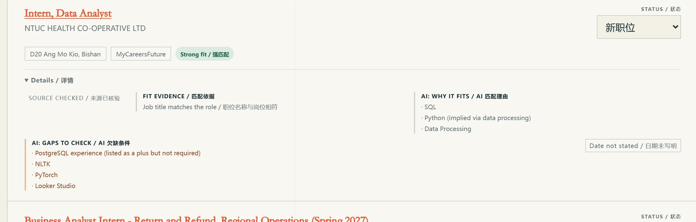
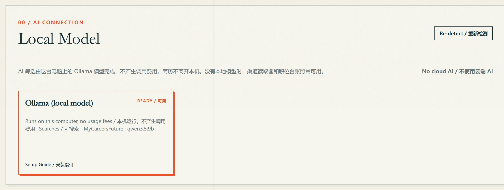

# Career Radar

[English](README.md) · [简体中文](README.zh-CN.md)

一个 Windows 求职工具，用来找新加坡、中国大陆和中国香港的实习与正式工作。导入简历后，它会推荐岗位，到你选的招聘网站读取职位，
用你电脑上运行的 AI 模型筛选，再汇总成一张可以跟进投递、导出 Excel 的列表。


## 下载

在[最新版本](https://github.com/shyfox-01/career-radar/releases/latest)页面下载 `CareerRadar-Setup-<版本>.exe`，双击安装。
适用于 64 位 Windows 10/11；AI 筛选和 MyCareersFuture 搜索还需要安装 Ollama，见[本地 AI](#本地-ai)。

- 安装包暂时没有数字签名，Windows 可能提示"Windows 已保护你的电脑"，点"更多信息"再点"仍要运行"即可。安装时选"只为我安装"就行。
- 安装版每次启动时会检查新版本，在后台下载，关闭程序后自动安装，记录不受影响。
- `CareerRadar-Portable-<版本>.exe` 是便携版，不用安装，记录保存在它旁边的文件夹里，不会自动更新。

## 一次搜索的过程

### 1. 导入简历

上传 PDF、DOCX、TXT、Markdown 文件，或直接粘贴文字。邮箱、电话、个人主页和住址会被去掉，搜索前先给你看去掉后的文字。



### 2. 选岗位和地区

程序根据简历推荐最多 12 个岗位名称，每个都有分数和对应的简历依据。只搜索你确认过的岗位。



### 3. 搜索

每个岗位和网站的组合就是一个任务，各有自己的搜索链接。大多数网站在独立的浏览器窗口里读取，和你平时用的浏览器分开；网站要求登录时，在那个窗口里登录。
MyCareersFuture 由 AI 模型搜索。



### 4. 查看职位列表

重复的职位会合并，按强匹配、相邻、宽泛分组。每个职位都保留原招聘链接，可以标记投递状态。



### 5. 看 AI 为什么留下这个职位

对它选出的职位，AI 会写下为什么匹配、简历还缺什么。职位名称、公司和链接都来自网站，AI 没法编造职位。



### 6. 导出 Excel

实习和正式岗位分别放在不同的工作表，覆盖情况表列出每个搜索读到了哪里。遇到登录、验证码或页数上限而停下的搜索，下次会接着搜。

## 招聘网站

默认读取：LinkedIn、JobStreet、Indeed、eFinancialCareers、BOSS直聘、智联招聘、前程无忧、猎聘、实习僧、牛客、JobsDB 和香港劳工处 iES。
其他网站可以手动开启，或提供搜索链接让你自己打开。

## 本地 AI

安装 [Ollama](https://ollama.com/) 和一个支持工具调用的模型：

```powershell
ollama pull qwen3.5:9b
```

程序会自动找到模型，Ollama 没开时会自己启动它。不需要账号和 API 密钥，每次搜索都不花钱，简历也不会离开你的电脑。没有 Ollama 时，除了 AI
筛选和 MyCareersFuture 搜索，其他功能都能用。



## 隐私

简历、职位和投递状态都保存在你的电脑上。招聘网站只会收到在它自己窗口里发出的搜索。Career Radar 不会替你投递、不会联系招聘方，也不会绕过网站的登录或验证码。
详见[隐私说明](PRIVACY.md)。

截图中的简历为虚构。

## 许可

可以免费用于自己的求职；再分发需要授权，详见 [LICENSE](LICENSE)。源码不公开。

作者：shyfox-01。
